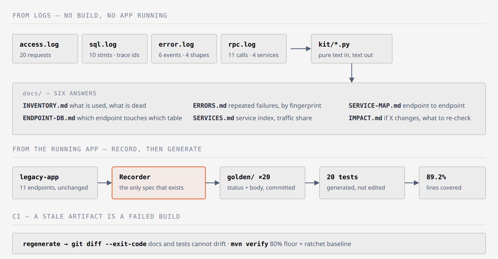

# legacy → tested, documented, gated

A Spring Boot 2.7 / Java 8 / SQLite service with **no tests, no docs, no CI** — and the pipeline that
turns it into a service with a 20-test suite, generated documentation, a service map, an impact index and
a coverage gate at 80%.

The repository is two branches on purpose, so the change can be reviewed as a diff:

```
main      the service as found        14 files · no tests · no CI · no docs · dead code present
revival   the same service, revived   60 files · 20/20 tests · 89.2% line coverage · CI gate
```

```bash
git diff main..revival --stat       # exactly what was added, nothing hidden
```

## The claim, in one line

> None of the tests, docs or maps below were written by hand from memory. Every one is generated from
> three kinds of evidence — sampled traffic, SQL logs, error logs — and regenerating them is part of CI,
> so they cannot drift.

## How the pieces fit



**Figure 1.** Two independent sources of evidence and one closed loop. The upper lane needs no build and no
running app: four log files become the inventory, the endpoint-to-table map, the error catalogue, the service
index, the endpoint-to-endpoint map and the impact index. The middle lane replays twenty sampled requests
against the app as it behaves today, stores the answers as goldens, and generates twenty tests from them —
the first specification this service has ever had. The lower lane is what keeps both honest: CI regenerates
every artifact and diffs it, so a document or a test that no longer matches the evidence fails the build
instead of quietly misleading the next reader.
Source: `docs/figures/revival-pipeline.html` (self-contained SVG).

## What gets produced, and from what

```
samples/access.log   20 sampled requests          -> inventory (ranked by traffic) + golden recordings
samples/sql.log      10 statements with trace ids -> endpoint -> table map, orphan tables
samples/error.log    6 events, 4 signatures       -> error catalogue with fingerprints
samples/rpc.log      11 cross-service calls       -> service map, endpoint->endpoint, impact index
```

| Output | Command | What it answers |
|---|---|---|
| `docs/INVENTORY.md` | `make maps` | what exists, what is used, what is dead, what to do first |
| `docs/ENDPOINT-DB.md` | `make maps` | which endpoint touches which table; which tables nobody touches |
| `docs/ERRORS.md` | `make maps` | which failures repeat, on which endpoint, and what test to write |
| `docs/SERVICES.md` | `make maps` | service index: endpoints, tables, callers, traffic share |
| `docs/SERVICE-MAP.md` | `make maps` | endpoint → endpoint, joined by trace id |
| `docs/IMPACT.md` + `.json` | `make maps` | if I change X, what else must be re-checked |
| `samples/golden/*.json` | `make record` | what the service actually answers, today |
| `GoldenMasterTest.java` | `make tests` | one test per recording, generated |
| `docs/API.md` | `make docs` | per-endpoint contract with real request/response |
| `out/CHANGED-IMPACT.md` | `make changed-git` | this diff touches these endpoints, tables, callers, recordings |
| `docs/SPANS.md` | `make spans` | what the test run actually executed, and whether the maps agree |

## Measured on this snapshot

```
tests              20/20 pass
line coverage      89.2%   (107/120)   floor 80%, ratchet baseline recorded at 89.2%
branch coverage    85.7%   (12/14)
method coverage    84.5%   (49/58)
generated artifacts 11 markdown files + 1 json, all reproducible
```

## The order that makes it possible

```
1  inventory     rank by traffic, not alphabet      -> 4 endpoints, 35% of traffic on one of them
2  record        replay the sample against the app  -> the only honest specification that exists
3  generate      one test per recording             -> 20 tests, zero hand-written assertions
4  cover         JaCoCo floor 80% + ratchet         -> the number cannot silently fall
5  document      from the recordings + logs         -> cannot drift, CI fails on a stale doc
6  gate          CI: regenerate, diff, verify       -> a stale map is a build failure
```

Coverage went 84.9% -> 89.2% with one change: deleting the class nothing referenced. That is the cheapest
coverage win in any legacy codebase, and the inventory finds it automatically.

## Traces, not drawings: the map is rebuilt from the test run

The suite writes `samples/spans.log` while it runs — one line per span, with `trace`, `span`, `parent`,
`method`, `path`, `status` and `duration_us`. `kit/spanmap.py` turns those spans into `docs/SPANS.md` and,
more importantly, checks the maps against them.

```bash
make spans                            # rebuild docs/SPANS.md from the traces
python3 kit/spanmap.py --check        # documented endpoints must equal executed endpoints
```

```
traces=20 spans=40 endpoints_ran=5 endpoints_documented=5
RESULT spans=ok
```

Two failures this catches that no amount of reading catches:

```
ran but not documented      a new endpoint exists and docs/API.md does not know it
documented but never ran    docs/API.md describes an endpoint the code no longer executes
```

Counting is per `(trace, call)`, not per span: a client span and its server span describe the same request,
so adding them would inflate the traffic — that inflation is exactly how a "most used endpoint" ranking goes
wrong.

| Call | Runs | p50 | max |
|---|---|---|---|
| `GET /api/customers/{id}` | 7 | 4.9 ms | 324.0 ms |
| `GET /api/legacy/ping` | 1 | 4.3 ms | 4.6 ms |
| `GET /api/orders/{id}` | 6 | 4.1 ms | 12.7 ms |
| `GET /api/reports/top` | 3 | 3.8 ms | 30.2 ms |
| `POST /api/orders` | 3 | 7.5 ms | 52.1 ms |

Those are a developer machine running the suite. They describe shape, not production latency — the table
says so in its own header, because a number without its context becomes a promise someone else quotes.

**Why not Testcontainers here.** Testcontainers earns its keep when a test needs a *real database* container.
This app is SQLite, so it would prove nothing. What was worth proving is that the packaged jar starts and
answers, and that is `make smoke`: build the image, run it, curl two endpoints, stop it, print the answer.

```
$ make smoke
OK  GET /api/legacy/ping -> {"ok":true}
OK  GET /api/customers/1 -> {"id":1,"name":"Alice",...
```

For a Postgres/MySQL project the same recording path works unchanged: point the recorder at the app the
Testcontainers run started, and the spans and the endpoint-to-table map come out of that run instead.

## When someone changes code: what else is affected

```bash
make changed FILES="legacy-app/src/main/java/com/example/legacy/model/OrderEntity.java"
make changed-git        # same, from `git diff HEAD` — what a pull request would touch
```

Real output for one entity file on this snapshot:

```
changed=1 mapped=1 unmapped=0 endpoints=4 -> out/CHANGED-IMPACT.md
  OrderEntity.java
    endpoints: GET /api/customers/{id}, GET /api/orders/{id}, GET /api/reports/top, POST /api/orders
    tests:     a001 … a020 (19 of 20 recordings)
```

`out/CHANGED-IMPACT.md` lists four things per changed file: **endpoints** (declared there, or reading a table
the file owns), **tables reached**, **callers to notify** (from the trace ids in `samples/rpc.log`) and
**recordings to re-run**. A file it cannot map is printed as `UNMAPPED` with a reason — it is never reported
as "no impact", because that is the one answer that causes incidents.

CI runs `changed.py --git` on every pull request and writes the impact list into the run summary.

## Optional: an AI on top — never inside the numbers

Everything above is deterministic. The advisor is the one place a model may look, and it is deliberately
outside the pipeline: it reads the artifacts, it may only rank and suggest, and it can be removed without
changing a single test, map or coverage point.

```bash
make advise-prompt    # 9 deterministic checks on the prompt contract — no key, no request
make advise-dry       # print the exact prompt, its size and its token estimate — no key, no request
make advise-fixture   # replay a saved response through validate + render — no key, no request
make advise           # one real call against any OpenAI-compatible endpoint
```

Three environment variables, no provider hard-coded, no SDK:

```bash
export OPENAI_BASE_URL=https://api.openai.com/v1     # or your own gateway / Command Code / vLLM
export OPENAI_MODEL=gpt-4o-mini
export OPENAI_API_KEY=sk-...                          # read from the environment, never written to disk
make advise
```

Any OpenAI-compatible `/chat/completions` endpoint works. Two things learned by running it against a
non-OpenAI gateway: `response_format` is not always supported (the client falls back once, automatically),
and the default `urllib` agent can be refused with `403 error code: 1010` — so the client sends an explicit
`User-Agent`. Nothing about a provider is committed to this repository; bring your own.

**A local run has one job: does the wiring work, and does the prompt say what it must say.** Not "is the
advice good" — that needs a person reading `docs/ADVICE.md`. `make advise-prompt` answers the first question
without a network call:

```
prompt: 2672 chars ≈ 668 tokens
  PASS role split          PASS output schema
  PASS no invention        PASS citation contract
  PASS evidence only       PASS rank only
  PASS refusal path        PASS bounded size
  PASS no secret
  evidence ids: 34 · unrecognised tokens in the pack: 0
```

Nine properties, each one an assertion on the prompt text, so a future edit that quietly drops "do not
invent facts" or the `cites` contract turns the build red instead of producing confident nonsense.

`--dry-run` on this snapshot:

```
pack 1233 chars · prompt 2177 chars ≈ 544 tokens   (gpt-4o-mini: well under a cent per run)
```

**Two guardrails, enforced in code, not in the prompt:**

```
citation check   every suggestion must cite an id that exists in the pack (endpoint, F1..F6, E-<fp>, artifact)
                 unknown citation -> suggestion dropped, and printed
number check     every number in a suggestion must already exist in the pack
                 invented metric -> suggestion dropped, and printed
```

The fixture proves both: three suggestions survive, and *"reduce latency by 40%"* is dropped because `40`
appears nowhere in the evidence. A model that invents a percentage cannot get it into `docs/ADVICE.md`.

A real run on this snapshot (`deepseek/deepseek-v4.1-flash` through a third-party gateway) returned 7
suggestions and all 7 passed both guardrails: every line cited an artifact that existed in the pack, and no
number appeared that the pack did not already contain. Usage reported by that endpoint: 681 prompt tokens,
1 884 completion tokens (1 370 of them reasoning). An earlier run of the same prompt returned 9 suggestions.

**That difference is the reason this file is advisory.** The model is not deterministic, so its output can be
reviewed, diffed and ignored — but never asserted. Every number that a build depends on comes from the
deterministic steps above.

**What it is not** (also written at the bottom of every generated advice file): not a measurement, not part
of the gate, and deleting it changes nothing about the tests. CI runs `--dry-run` and `--check` only, so the
build never depends on an API key, a network call or a provider's uptime.

## What the evidence found in the code

All six are in [`docs/FINDINGS.md`](docs/FINDINGS.md) with the artifact that proves each one:

```
N+1            GET /api/customers/{id} -> 4 statements for one request
magic number   the 7% fee lives as a literal in LegacyService.createOrder
swallowed      createOrder catches Exception, prints, returns null  -> HTTP 200 on a failed write
collision      order id comes from System.currentTimeMillis()
orphan table   legacy_flags is never read or written
dead code      LegacyDeadCode referenced by nothing (removed in this branch)
```

## What this does NOT prove

- **The sample logs are synthetic.** They imitate a production shape; they are not production data.
  The pipeline is what is being demonstrated, not the statistics of this service.
- **Only traffic that exists can be recorded.** Refunds, admin screens, scheduled jobs: no traffic, no
  test. `docs/FINDINGS.md` says so instead of pretending coverage is complete.
- **A characterization test protects current behaviour, bugs included.** `GET /api/customers/999`
  returns 200 with an empty body; the test locks that in. Approving a behaviour is a human step.
- **`why 7%` is not recoverable from any log.** Intent needs a person; the artifacts can only say what.

## Reproduce

```bash
make maps        # regenerate every map from samples/ (no build needed)
make record      # replay samples/access.log against the app -> samples/golden/
make tests       # generate the suite from the recordings
make verify      # run the suite + JaCoCo (fails under 80%)
make coverage    # coverage report + ratchet
make all         # the whole chain
```

Requires docker (Maven + JDK 8 image) and python3. No Java on the host.
